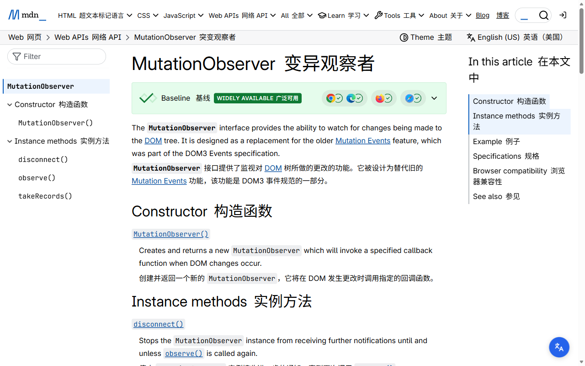

# Inline Translator

A lean inline web page translator for Chrome / Edge / Firefox.

## Features

- **Adaptive engine**: Block/inline decided by computed display; unknown sites work out of the box.
- **Layout-safe placement**: Labels translate inline right of the original; prose gets its own line.
- **Style inheritance**: Translations match the original typography, with 17 optional themes (underlines, borders, highlight, quote, blur, transparency, …) and a live popup preview.
- **Rich text**: Placeholder round-trip, restored and sanitized.
- **Dynamic content**: Debounced rescans, SPA restarts, Shadow DOM & same-origin iframe piercing.
- **Efficient**: Viewport-lazy translation, frame-batched rendering that keeps the scroll position, batching, persistent LRU cache.
- **Services**: Google / Edge built-in endpoints or any OpenAI-compatible API.
- **Controls**: Curated + custom site rules, floating button, Alt+A (rebind it in the browser's extension shortcuts if another extension already owns it), context menu, popup, per-site auto-translate memory.

## Screenshot

<p align="center">
  
</p>

## Build

```sh
npm install

# Unpacked production build
npm run build            # Chrome / Edge
npm run build:firefox    # Firefox

# Package zip archives
npm run zip              # Chrome / Edge
npm run zip:firefox      # Firefox
```

## AI Disclosure

This project is developed entirely with LLM assistance, and no human code review has been performed.

## License

Licensed under [Apache License, Version 2.0](LICENSE).
